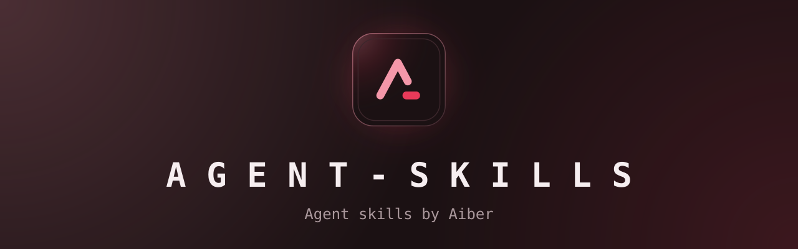
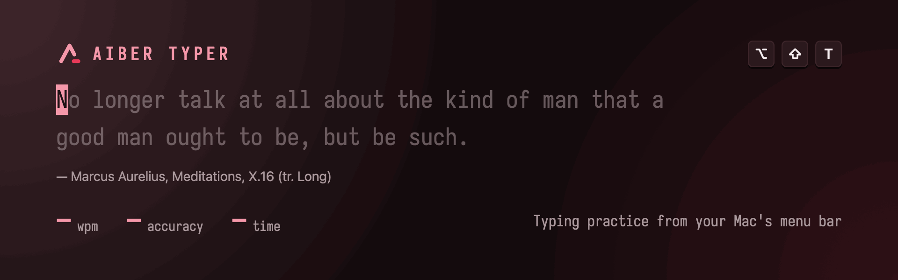
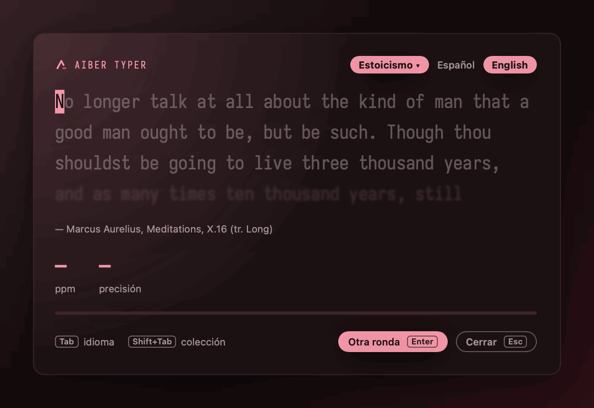
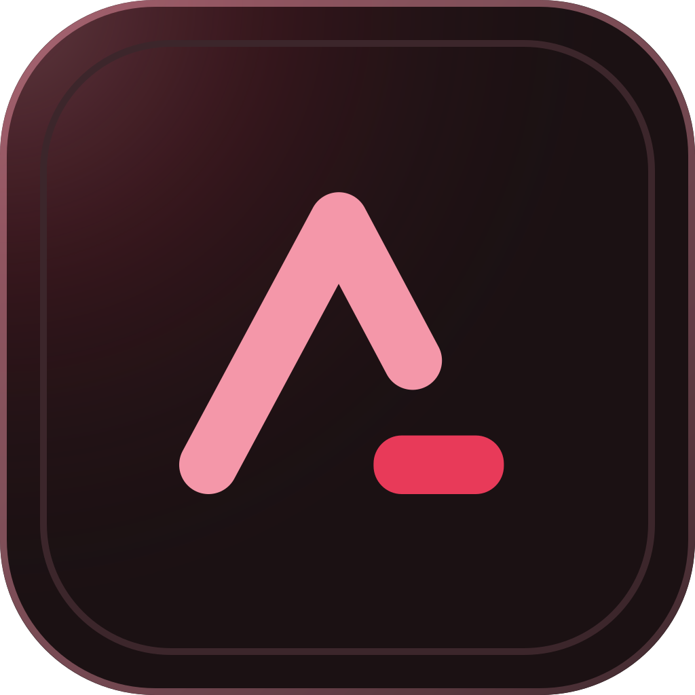

<a id="top"></a>

<div align="center">



<p><strong>Agent skills by Aiber, ready for any agent that reads SKILL.md.</strong><br/>
Install them with one command: <code>npx skills add AitorBermeRuiz/agent-skills</code></p>

<p>
<a href="https://skills.sh/AitorBermeRuiz/agent-skills"></a>

<a href="LICENSE"></a>
</p>

<p>
<a href="#install"><strong>Install</strong></a> &bull;
<a href="#skills"><strong>Skills</strong></a> &bull;
<a href="#showcase-readme"><strong>showcase-readme</strong></a> &bull;
<a href="#contributing"><strong>Contributing</strong></a>
</p>

</div>

---

Each skill is a folder with a `SKILL.md` that tells a coding agent how to do one job well, plus the scripts and references it needs. They come from real projects: every skill here was used to ship something before it was published.

## Install

```sh
npx skills add AitorBermeRuiz/agent-skills
```

<details>
<summary><b>One skill, globally, or a dry run</b></summary>

```sh
# List the skills in this repo without installing anything
npx skills add AitorBermeRuiz/agent-skills --list

# Install one skill for every project (user-level)
npx skills add AitorBermeRuiz/agent-skills --skill showcase-readme -g

# Update installed skills later
npx skills update
```

</details>

## Skills

| Skill | What it does |
|-------|--------------|
| [`showcase-readme`](skills/showcase-readme/SKILL.md) | Builds a polished README for an open-source project: brand banner, logo, real screenshots or demo GIF, badges and translations. |

## showcase-readme

Ask your agent to "make my README look polished" or "add a Spanish README", and it walks through eight steps: learn the project, find its palette, settle the logo, ask you once about languages and the banner, render banner options, capture the real product, write the README and verify every path and claim.

- **Your brand, never a default.** The palette and logo come from the project or from you; when there is none, it proposes options as rendered swatches.
- **Banners from one script.** [`banner.py`](skills/showcase-readme/scripts/banner.py) renders four 1280×400 SVG layouts, one of them animated, from a `palette.json`. Python 3 standard library only, no network.
- **Real proof.** Screenshots and demos come from the running product with throwaway data; [`visuals.md`](skills/showcase-readme/references/visuals.md) has the capture route per platform.
- **A section order that sells.** [`anatomy.md`](skills/showcase-readme/references/anatomy.md) and the [template](skills/showcase-readme/assets/README.template.md) fix the order from hero to footer.

<table>
<tr>
<td width="50%"></td>
<td width="50%"></td>
</tr>
<tr>
<td colspan="2" align="center"><sub><strong>Made with it.</strong> The <a href="https://github.com/AitorBermeRuiz/AitorTyper">AiberTyper</a> README, the project this skill was extracted from. Both images are rendered from the real app.</sub></td>
</tr>
</table>

Needs Python 3 for `banner.py`. `rsvg-convert` (librsvg) or a browser turns the SVGs into PNG previews.

## Contributing

Skills live in `skills/<name>/SKILL.md`; the frontmatter needs `name`, `description` and `license`. Check that the CLI finds a new skill before opening a pull request:

```sh
npx skills add AitorBermeRuiz/agent-skills --list
```

The banner at the top was made by the skill itself; the exact command is in a comment inside [`docs/assets/banner-en.svg`](docs/assets/banner-en.svg), and `banner-alt-en.svg` is the animated runner-up.

## License

[MIT](LICENSE).

<div align="center">
<br/>

<br/>
<sub>Agent skills by Aiber · <a href="#top">back to top ↑</a></sub>
</div>
